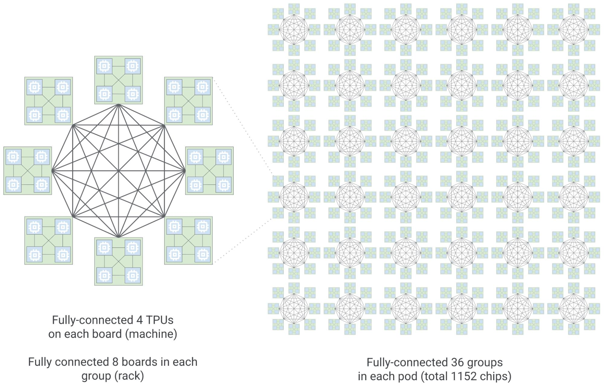
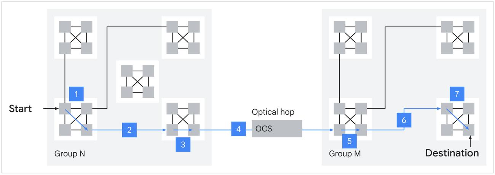

# Boardfly 4×8×36

Минимальный стенд: иерархия TPU 8i (4 чипа × 8 блоков × 36 групп = 1152 узла) в [BookSim 2.0](https://github.com/booksim/booksim2).



Слева — группа: 8 плат с полносвязными 4 TPU на каждой, платы тоже полносвязны. Справа — 36 таких групп в pod (1152 чипа).

```bash
sudo apt-get install -y build-essential flex bison python3
git submodule update --init --recursive
make
```

`scripts/boardfly.py` строит канонический граф (K4 на плате, K8 по меди, K36 через OCS), проверяет инварианты и гоняет uniform-трафик.

Диаметр **7**: худший путь между чипами разных групп — три hops в группе-источнике, один оптический hop через OCS и три hops в группе назначения.



Ожидаемый вывод:

```
n=1152 deg=4-7 mean=5.844 diam=7 asp=5.211 links=3366
inj=0.02 latency=26.866 hops=6.202 accepted=0.020
```
